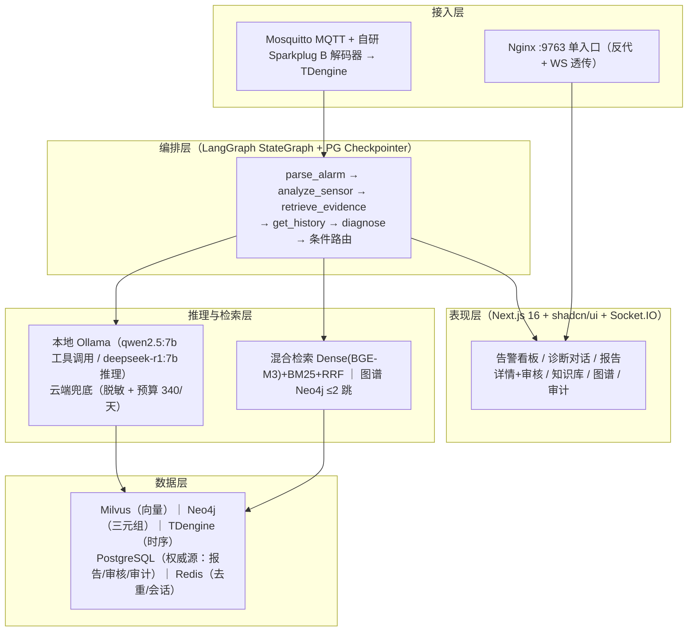
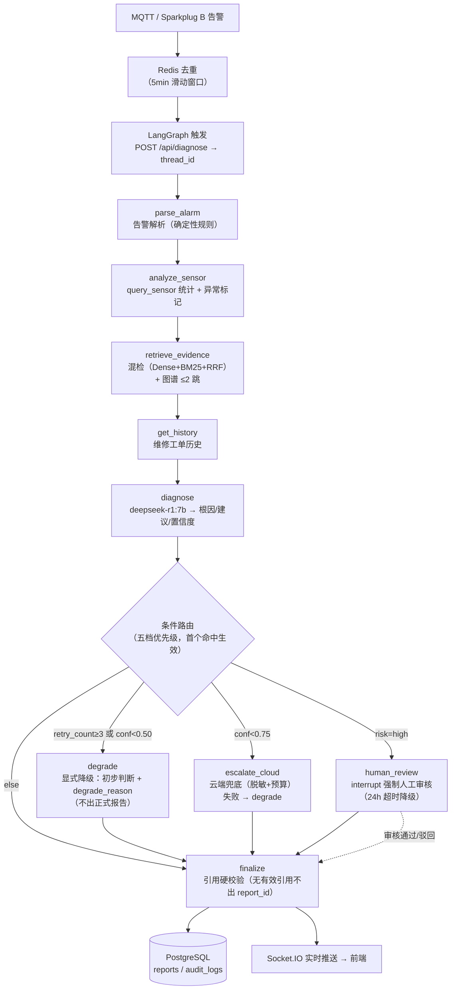

# 需求主流程（Requirements Main Flow）

> **层级**：项目级长期有效（跨阶段）｜ **状态**：🟢 **活动** ｜ **最近更新**：2026-10-15
> **定位**：以「触发 → 查数 → 决策 → 产出 → 审核 → 审计」主流程视角，对系统需求的端到端总结；供新成员快速理解与评审对照使用。
> **权威口径**：架构细节以 `docs/prj-design-architecture.md` 为准；阶段状态以 `docs/p6-gate-closure-2026-10-10.md` 为准；本文不重复、不覆盖上述权威口径。
> **对照参考**：本文结构参照「采购 ERP 需求主流程」样例（角色 → 核心问题 → 查库存 → 自动下单/出单 → 多级审核 → 自动付款）同构映射。

---

## 一、项目定位（角色视角）

| 参考样例（采购 ERP） | auscult（工业 IoT 诊断 Agent） |
|---|---|
| 角色：采购经理 | 角色：设备运维工程师 / 诊断 Agent（RBAC 三角色 + 知识库管理员） |
| 两个核心问题：要采购什么？采购多少？ | 两个核心问题：这条告警**是什么故障**？**依据是什么**（结论必须带出处） |
| 查库存系统 → 对照安全库存 20 → 算采购量 | 查传感器时序（TDengine）+ 知识库（Milvus 混检）+ 图谱（Neo4j）+ 维修工单历史 → 组装证据集 |
| 调用第三方接口下单 / 生成 PDF 订单 + 公章 | 生成结构化报告（结论 + `EvidenceItem` 引用 + 置信度），引用硬校验，不出无源结论 |
| 采购经理审 → 财务经理审 → 自动付款 | 高风险 → `interrupt()` 强制人工审核（SoD：提交人不得自审）→ 定稿 + append-only 审计 |
| 接口升级为 MCP 供 AI 调用 | **差异点**：工具通过 `schemas/tools_v4.json` JSON Schema + 约束解码实现自动调用，未 MCP 化 |

---

## 二、分层架构总览

> 各层职责与组件细节以 `docs/prj-design-architecture.md` 为权威口径，本图仅作主流程导航。



---

## 三、在线诊断主流程（核心链路）

> 实现位置：`app/graph/build.py`（六节点 StateGraph + 条件路由）。

### 3.1 主流程架构图




```
MQTT/Sparkplug B 告警 → Redis 去重(5min 滑动窗口) → LangGraph 触发
  → parse_alarm        告警解析（确定性规则）
  → analyze_sensor     query_sensor（avg/max/min/p95/trend + 异常标记）
  → retrieve_evidence  retrieve_knowledge(Dense BGE-M3 + BM25 + RRF) + query_graph(≤2跳)
  → get_history        get_maintenance_history（历史工单）
  → diagnose           deepseek-r1:7b 推理 → root_causes + suggestions + confidence
  → 【条件路由，五档优先级，首个命中生效】
      ├─ retry_count≥3 / confidence<0.50        → degrade（显式降级：初步判断+degrade_reason）
      ├─ confidence<0.75                        → escalate_cloud（脱敏+预算340/天，失败再降级）
      ├─ risk_level=="high"                     → human_review（interrupt，24h超时降级）
      └─ else                                   → finalize（引用硬校验：无有效引用不出 report_id）
  → Socket.IO 推送 → PG 落库(reports/audit_logs) → 审计
```

### 3.2 三档置信度阈值（易混，务必区分）

| 阈值 | 用途 | 行为 |
|---|---|---|
| 0.50 | 降级线 | `< 0.50` 只出「初步判断，建议人工确认」，不出正式报告 |
| 0.60 | 强制审核线 | `< 0.60` 强制人工审核（见 `docs/prj-spec-review-lifecycle.md` §2.2） |
| 0.75 | 自动生成线 | `≥ 0.75` 达自动生成线，审核通过后可生成正式报告 |

三者是**不同用途的独立阈值**，不是同一参数的三种口径。

### 3.3 主流程验收要点（Demo S1，见 `demo/scenario.md`）

- 引用硬校验：引用无效时 `finalize` 不产出 `report_id`，thread 带 `E_INVALID_CITATION`（属「正确地拒绝」，不可绕过）；
- 高风险覆盖率 100%：`risk=high` 必进审核（五档路由第 4 档）；
- 职责分离：提交人不得自审（`E_PERMISSION` 拒绝）；
- 时序数据未灌入时 `analyze_sensor` 走降级（`E_TD_TIMEOUT`），报告仍可生成。

---

## 四、离线知识构建流

```
PDF/工单/规程 → MinerU 解析 → Parent-Child 分块 → 元数据标注
  → 三写：Milvus(向量) + Neo4j(三元组) + PostgreSQL(元数据/版本)
  → 【Outbox 对账】确认三写一致
```

---

## 五、业务数据管理流

```
登录(RBAC) → 告警/报告/知识库查询 → 审核(通过/驳回+意见) → 知识库更新(版本升版) → 审计
```

---

## 六、系统边界（七模块 × 参考样例「6 个系统」映射）

| # | 参考样例系统 | 本项目模块 | 关键产出 |
|---|---|---|---|
| 1 | 库存系统 | IoT 接入与告警（Mosquitto + 自研 Sparkplug B 解码器 → TDengine） | 告警事件流 |
| 2 | 采购系统 | 报告与审核（`generate_report`，结构化 + 引用强制） | 带出处报告 |
| 3 | 第三方对接 | 云端兜底（脱敏摘要 + 结构化参数，不传证据原文） | 升级诊断 |
| 4 | RAG | 知识库管理 + 混合检索（Recall@5=1.0、P95=86 ms） | 证据集 |
| 5 | 银联 | **无支付环节** —— 本项目在「审核」处闭环，不做资金动作 | — |
| 6 | 自动出报告 | 报告生成 + Socket.IO 实时推送 | 报告 + 审计 |
| 7 | —（样例没有） | 权限与审计（RBAC 三角色 + `audit_logs` append-only） | 审计日志 |

---

## 七、安全刚性与现状声明

- **永久 Won't**：自动执行维修动作（安全刚性）、多租户、移动端、>2 跳 GraphRAG（见 `docs/p0-spec-scope-mvp.md` §三）；
- **已知未达标项**（收口文档如实接受）：端到端 P95 = 9,248.8 ms（> 3 s 目标，瓶颈 = 生成输出长度）；置信度 ECE = 0 属零方差巧合性校准；
- 所有指标结论均带「模拟数据初步验证」局限声明，golden 50 题待扩语料后重评；
- 项目已于 2026-10-10 `M6.4` 收口，进入维护期（只修缺陷，不扩范围）。

---

## 八、一句话主流程

**告警进、证据聚、AI 诊断、报告出、高风险人审、全程留痕** —— 与采购 ERP 样例同构（触发 → 查数 → 决策 → 产出 → 审核 → 审计），区别是审核环节到「人工审核」为止、无支付动作，且 AI 调工具靠 JSON Schema 约束解码而非 MCP。

---

## 修订记录

| 日期 | 修订人 | 原因 | 影响范围 |
|---|---|---|---|
| 2026-10-15 | 单人（本人） | 初始建立：按「采购 ERP 需求主流程」样例同构梳理项目需求主流程 | 全文 |
| 2026-10-15 | 单人（本人） | 增补架构图：新增 §二 分层架构总览（Mermaid）与 §3.1 主流程架构图（Mermaid），章节编号顺延 | §二、§三 及其后编号 |
