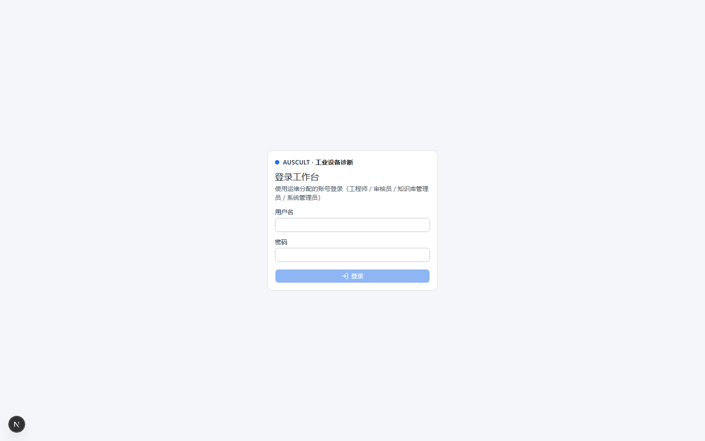
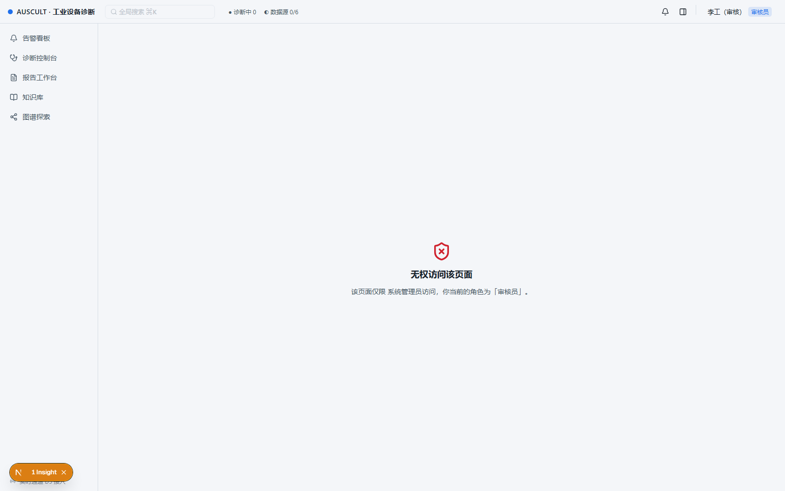
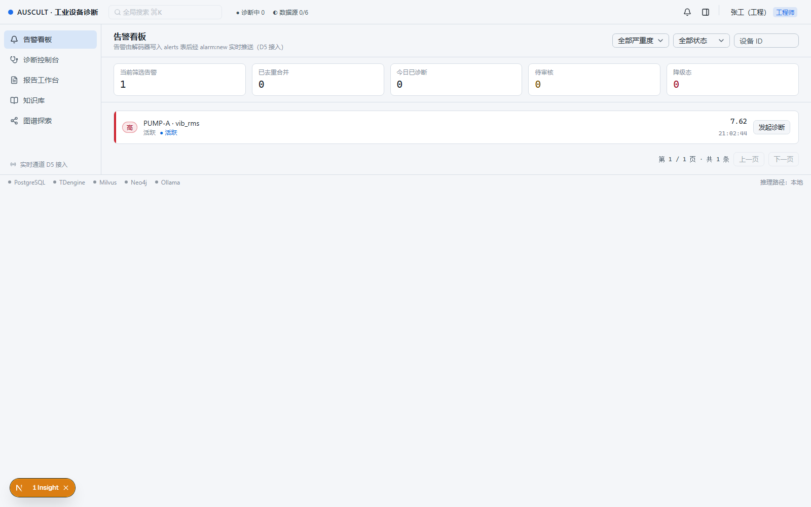
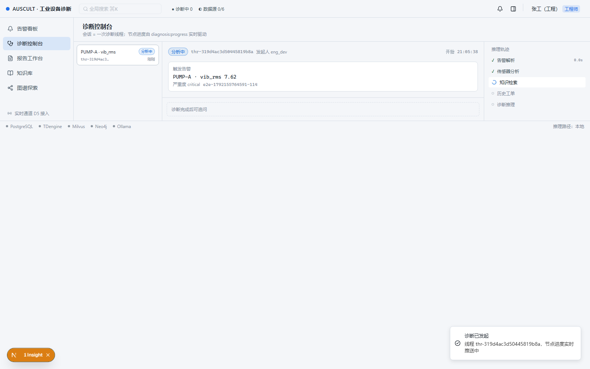
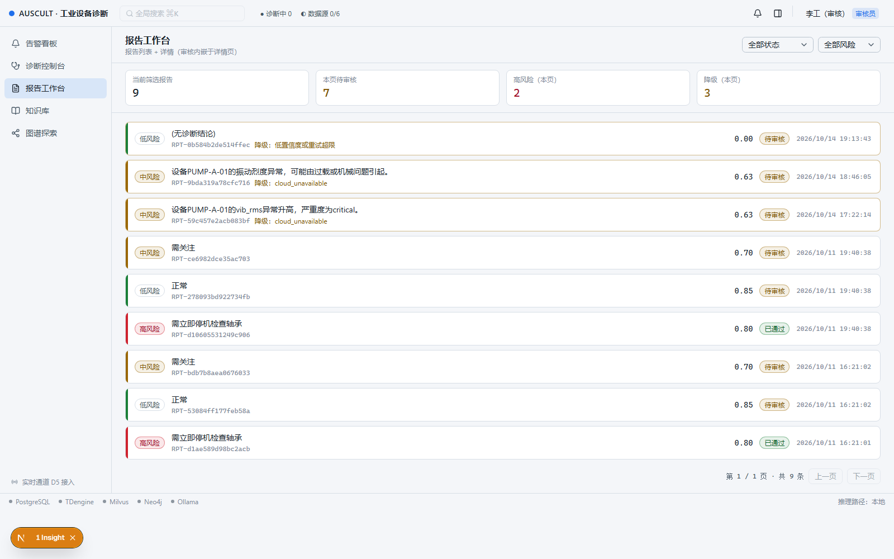
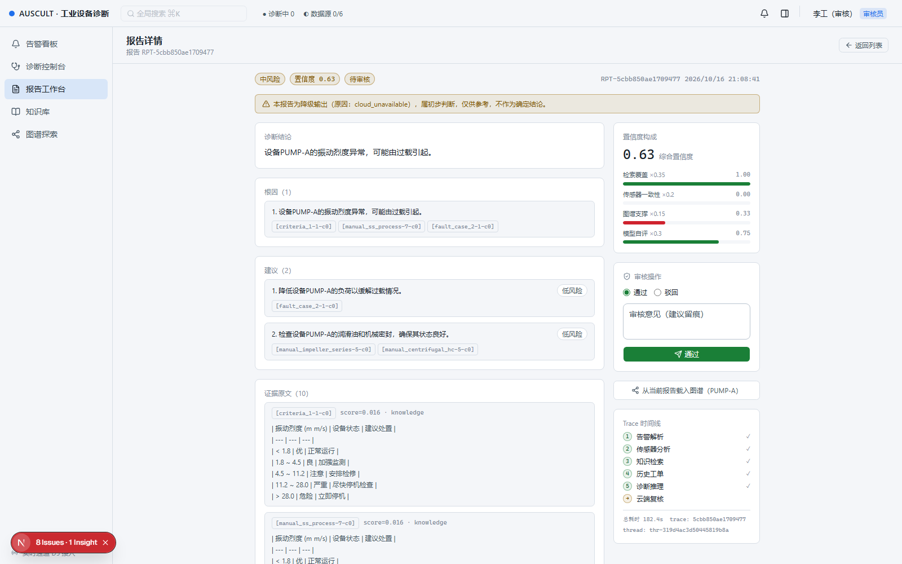
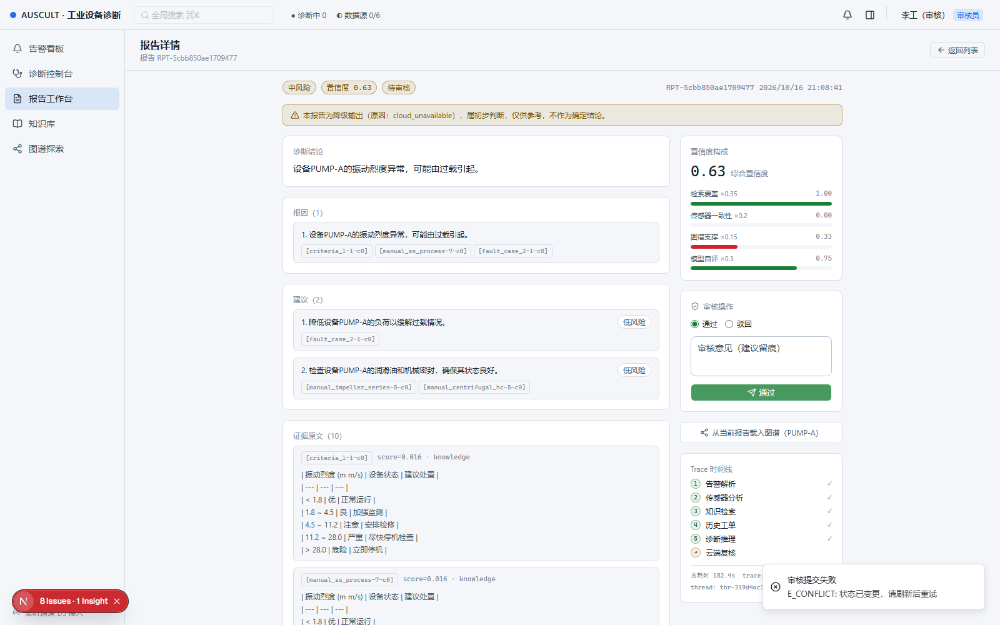
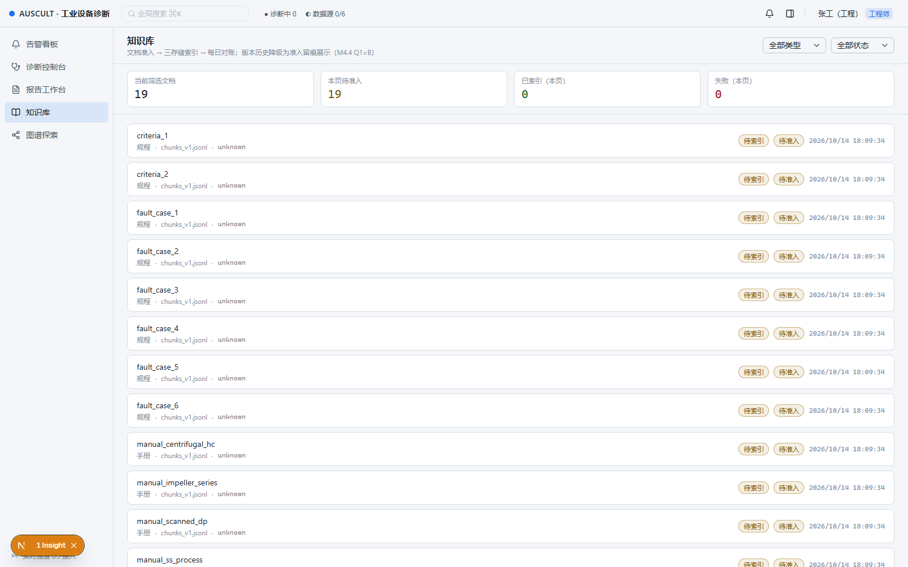
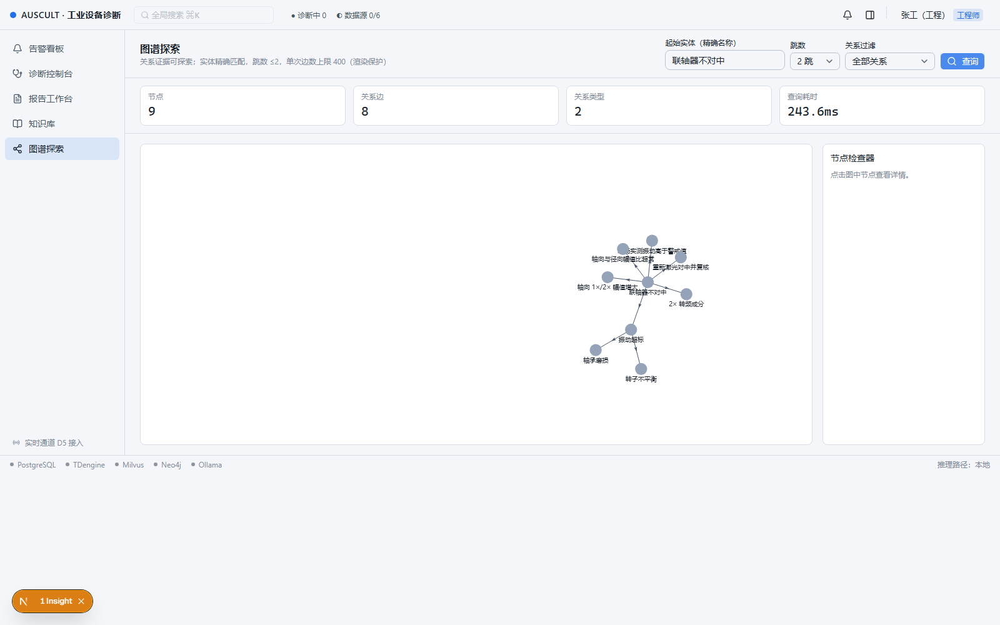
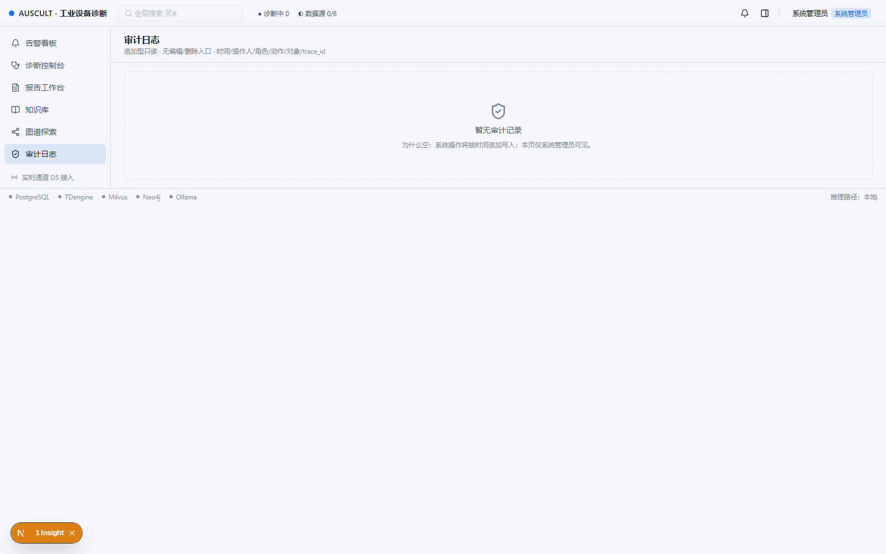

# auscult 用户操作手册

> **类型**：`guide`（用户操作手册）｜ **状态**：🟢 **活动** ｜ **最近更新**：2026-10-16
> **适用读者**：设备运维工程师 / 审核员 / 知识库管理员 / 系统管理员（最终用户，非开发人员）
> **配套需求文档**：`docs/prj-design-requirements-main-flow.md`（主流程权威口径）；本手册是其「用户可操作视角」的展开
> **截图口径**：全部截图来自 **2026-10-16 实跑环境**（本机交付栈 + 本地 Ollama），非示意图；界面随版本演进可能有细节差异，以实跑为准
> **纪律声明**：本手册只描述**已验证可用的功能**；未完成/降级项在 §七「已知边界」如实列出，不美化、不虚构

---

## 一、这是什么

auscult 是一套跑在**本地**的工业设备诊断 Agent。一条设备告警进来，系统自动完成「**查传感器数据 → 查知识库 → 查图谱 → 查历史工单 → AI 推理 → 出具带出处的报告**」，高风险结论**强制人工审核**，全程留痕。

用一句话概括主流程（与需求文档 §八一致）：

> **告警进、证据聚、AI 诊断、报告出、高风险人审、全程留痕。**

### 你能用它做什么

| 角色 | 核心工作 |
|---|---|
| **工程师**（`eng_dev`） | 看告警看板、对告警发起诊断、跟踪诊断进度、查看报告 |
| **审核员**（`rev_dev`） | 待审核队列、审核报告（通过/驳回+意见）、查看报告详情 |
| **知识库管理员**（`kb_dev`） | 维护知识库文档（索引/准入状态跟踪） |
| **系统管理员**（`sys_dev`） | 全部页面 + 审计日志 |

---

## 二、快速开始（从零到跑通）

> 以下步骤在 **Windows + Docker Desktop** 环境实测通过（2026-10-16）。开发/运维细节见 `docs/prj-spec-deployment.md`。

### 2.1 启动基础设施（一条命令）

```powershell
cd <REPO>
.\deploy\up.ps1        # 启动 9 个容器（PG/Milvus/Redis/Neo4j/Mosquitto/TDengine/etcd/minio/Nginx）
```

看到 `[OK] Services started` 且容器状态为 `healthy` 即就绪。

### 2.2 初始化（幂等，可重复执行）

```powershell
.\deploy\init.ps1     # 建表/建库/建图谱/导入语料与元数据/三写对账
```

看到 `[DONE] Initialization complete` 且「三写对账」为**零差异**即就绪。

### 2.3 （可选）灌入时序样本数据

如需传感器分析真实生效（而非降级），需灌入时序样本数据：

```powershell
# 终端 1：常驻解码器（订阅 MQTT → 写 TDengine）
.venv\Scripts\python.exe scripts\self_decoder.py --prj-spec-schema-mapping configs\decoder_schema_mapping.json --mqtt-host 127.0.0.1 --td-host 127.0.0.1
# 终端 2：批量造数（3 设备 × 1 小时 × 1Hz，PUMP-A 注入异常段）
.venv\Scripts\python.exe scripts\gen_sparkplug.py
```

灌数完成后关闭终端 1 即可，已落库数据不受影响。详细口径见 `README.md` §五。

### 2.4 启动应用服务（开发模式）

```powershell
# 终端 1：后端 API + Socket.IO
.venv\Scripts\python.exe -m uvicorn app.api.main:socket_app --host 0.0.0.0 --port 8000
# 终端 2：前端
cd client
pnpm dev -- -H 0.0.0.0
```

### 2.5 访问入口

**浏览器打开 `http://localhost:9763`**（Nginx 单入口，反代前端 + API + WebSocket）。

> ⚠️ **必须用 `localhost`，不要用 `127.0.0.1`** —— 后者会被 Next.js 开发模式的跨源保护拦截，表现为「页面能打开但按钮全灰、永远转圈」（已知问题 `ISS-043`，开发模式特性，生产构建不受影响）。

---

## 三、登录与账号

### 3.1 登录

打开 `http://localhost:9763`，进入登录页：



输入运维分配的账号密码，点击「登录」。演示环境内置四个角色账号：

| 账号 | 角色 | 能做什么 |
|---|---|---|
| `eng_dev` | 工程师 | 告警看板、发起诊断、诊断控制台、报告工作台（查看） |
| `rev_dev` | 审核员 | 报告工作台（**审核操作**）、告警看板（只读） |
| `kb_dev` | 知识库管理员 | 知识库维护（**无诊断权**） |
| `sys_dev` | 系统管理员 | 全部页面 + 审计日志 |

演示环境默认密码：`Auscult#Dev2026`（生产环境必须修改）。

### 3.2 权限边界（RBAC）

权限由后端强制校验，前端只是反映。实测行为：

- **工程师/系统管理员**登录后进入全部工作台；
- **审核员**访问审计页 → 「无权访问该页面」（仅系统管理员可见）；
- **知识库管理员**只读知识库，**无「发起诊断」按钮**（后端同口径拦截）。



> 上图为审核员账号访问审计页的真实截图——**看到这个页面说明权限守卫正常工作**，不是系统故障。

---

## 四、功能操作指南

### 4.1 告警看板（`/alarms`）

**是什么**：所有设备告警的列表，按严重度/状态/设备可筛选。新告警通过 WebSocket **实时推送**（无需刷新，2 秒内到达并高亮）。



**怎么看**：

- 顶部 KPI：当前筛选告警 / 已去重合并 / 今日已诊断 / 待审核 / 降级态；
- 列表每条：设备、测点、当前值 vs 阈值、严重度徽章（高=红/中=橙/低=灰）、时间；
- 右上角筛选：严重度、状态、设备 ID。

**怎么触发诊断**：点击告警卡片上的「**发起诊断**」按钮 → 系统创建诊断线程并跳转诊断控制台。

> 告警从哪来：生产形态由「MQTT 数据 → 解码器 → 告警引擎 → `alerts` 表」链路写入（阈值判据见 `configs/alarm_rules.yml`）。演示/测试环境可用 `scripts\insert_test_alarm.py` 预置一条告警。

### 4.2 诊断控制台（`diagnosis`）

**是什么**：一次诊断的完整过程回放。左侧会话列表，右侧「推理轨迹」逐步展示 AI 的思考路径，底部实时日志。



**推理轨迹六个节点**（自上而下逐步打勾）：

| 节点 | 做什么 |
|---|---|
| ① 告警解析 | 确定性规则解析告警（设备/测点/阈值/严重度） |
| ② 传感器分析 | `query_sensor` 聚合时序数据（avg/max/趋势 + 异常标记） |
| ③ 知识检索 | 混合检索：向量（BGE-M3）+ 关键词（BM25）+ RRF 融合 |
| ④ 历史工单 | 查维修工单历史（同类故障处理经验） |
| ⑤ 诊断推理 | 本地 LLM（deepseek-r1:7b）综合证据给出根因/建议/置信度 |
| ⑥ 云端降级 | 置信度不足时尝试云端升级；不可用则显式降级 |

**耗时预期**：热启动约 30–90 秒；**首次诊断（后端刚启动、模型首次加载）可能 3–5 分钟**，请耐心等待轨迹打勾，不要刷新。

### 4.3 报告工作台（`/reports`）

**是什么**：所有诊断报告的列表与详情。报告是诊断的正式产出，**结论必须带证据出处**。



**报告详情页包含**（审核员/工程师视角）：



- **风险徽章 + 置信度**：中风险/高风险/低风险；置信度 0–1 综合分；
- **降级提示**（如有）：如「本报告为降级版输出（原因：云端不可用）」——降级不是故障，是明确的诚实标注；
- **诊断结论**：一句话概述；
- **根因（带引用）**：每条根因后跟 `[chunk_id]` 引用，点击可定位到证据原文；
- **建议（带引用）**：维修建议 + 风险标签（低/中/高）；
- **置信度构成**：检索质量 / 传感器一致性 / 图谱支撑 / 模型自评 四因子分解；
- **证据原文**：检索命中的文档片段全文（含相关度分数与来源），**这就是「带出处」的实处**；
- **Trace 时间线**：六个节点的实际耗时；
- **审核操作区**（审核员可见）：通过 / 驳回 + 意见填写。

**审核怎么操作**（审核员角色）：

1. 在报告工作台点开「待审核」报告；
2. 阅读结论、根因引用与证据原文；
3. 选择「通过」或「驳回」，填写审核意见；
4. 提交后报告状态更新（待审核 → 已通过/已驳回），全程写入审计。



> **职责分离（SoD）**：提交人不得审核自己的报告——工程师发起的诊断，必须由审核员账号审核。

### 4.4 知识库（`/knowledge`）

**是什么**：诊断所依据的文档资产（规程/判据/故障案例/设备手册/维修工单），按「当前筛选文档 / 本页待入 / 已入本页 / 失败」统计。



- 每条文档显示：标题、类型（规程/手册/案例…）、来源分块文件、**索引与准入状态徽章**（待索引/待入…）、入库时间；
- 知识库管理员在此跟踪文档从「待索引」到「已准入」的全流程。

### 4.5 图谱探索（`/graph`）

**是什么**：设备知识图谱的可视化查询（Neo4j，实体精确匹配，最多 2 跳、单次 400 边渲染保护）。



**怎么查**：

1. 「起始实体」输入**精确实体名**（如 `联轴器不对中`、`振动烈度`、`驱动端轴承温度`）；
2. 选跳数（1–2 跳）与关系过滤；
3. 点「查询」→ 展示节点/关系图 + 节点检查器（点击节点看详情）。

> 图谱数据来自合成语料的三元组抽取（105 节点 / 127 关系 / 11 类受控关系），规模有限；诊断主证据仍以文档检索为主，图谱是**补充佐证**。

### 4.6 审计日志（`/audit`，仅系统管理员）

**是什么**：系统操作的审计追踪（谁、何时、做了什么）。



**当前口径（如实说明）**：

- **RBAC 守卫已生效**：非系统管理员访问被拒绝（见 §3.2 截图）；
- **PG 审计层**（`audit_logs` 表，append-only 防篡改）当前覆盖**安全与限流事件**（如限流触发），可经数据库直接查询；
- **业务审计双轨**在 JSONL 文件：`reports/review_audit.jsonl`（审核生命周期）、`reports/cloud_audit.jsonl`（云端调用脱敏审计）、`reports/traces/<thread_id>.jsonl`（诊断全程 Trace）；
- ⚠️ **前端审计页的数据接入（API）尚未完成**（既有待办，P4-D20 范围），因此页面当前显示空态——**这是已知未完成项，不是数据丢失**；审计数据以上述文件与 PG 表为准。

---

## 五、主流程走查：一次完整的振动诊断（S1）

以下为 2026-10-16 **实跑**口径（工程师 `eng_dev` 全程操作）：

| 步骤 | 操作 | 实测结果 |
|---|---|---|
| 1 | 工程师登录 → 告警看板 | 实时收到 `PUMP-A / vib_rms` 告警（critical） |
| 2 | 点「发起诊断」 | 创建线程 `thr-319d4ac3…`，跳转诊断控制台 |
| 3 | 观察推理轨迹 | 告警解析 ✅ → 传感器分析 ✅（读到 10800 行时序中的 PUMP-A 数据，vib_rms 峰值 4.855 mm/s 越 ISO 10816 C 区上界）→ 知识检索 ✅ → 历史工单 ✅ → 诊断推理 ✅ |
| 4 | 云端降级节点 | 云端超时（20.2s）→ **显式降级** `cloud_unavailable`，报告标注降级原因，**不影响产出** |
| 5 | 报告生成 | `RPT-5cbb850…`，置信度 0.63，风险 **medium** → 进入待审核队列 |
| 6 | 审核员登录 → 报告工作台 | 看到该报告「待审核」 |
| 7 | 点开报告 → 阅读证据 → 点「通过」 | 状态更新为已通过，操作写入审计 |
| 8 | 审计留痕 | `cloud_audit.jsonl` 记录云端调用（含脱敏 hash、预算计数）；`traces/` 记录全程 Trace |

**这一跑验证了什么**：证据驱动（根因/建议全部带引用）、传感器数据真实生效、降级路径诚实可见、审核闭环、全程留痕——与需求文档 §三 主流程逐环节对应。

---

## 六、常见问题（FAQ）

**Q1：页面能打开，但按钮点不动、一直转圈？**
开发模式下请确认地址是 `localhost:9763` 而非 `127.0.0.1:9763`（见 §2.5）；若偶发「ChunkLoadError」红色遮罩，**刷新页面**即可（Turbopack 开发服务器已知现象，不影响数据）。

**Q2：告警看板是空的？**
正常——告警由数据链路实时产生。演示可用 `scripts\insert_test_alarm.py --device PUMP-A --metric vib_rms --severity critical` 预置一条。

**Q3：诊断停在「知识检索」很久？**
首次诊断需加载嵌入模型（约 15s）+ 建索引，属正常冷启动；后续诊断会快很多。

**Q4：报告里出现「降级」字样，是出错了吗？**
不是。降级是**明确的诚实标注**：云端不可用/置信度不足时，系统输出「初步判断」并注明原因，而不是编造结论。看到降级报告照样要认真看。

**Q5：传感器分析显示没有数据？**
时序样本数据需单独灌入（§2.3）。未灌数时 `analyze_sensor` 走降级（`E_TD_TIMEOUT`），报告仍可生成——证据驱动不依赖传感器数据。

**Q6：审核员看不到「发起诊断」按钮？**
设计如此——诊断发起权归工程师/系统管理员（后端强制）。知识库管理员为只读。

**Q7：审计页是空的？**
见 §4.6 当前口径：RBAC 守卫已生效，前端数据接入（D20）是既有未完成项；审计数据以 `reports/*.jsonl` 与 PG `audit_logs` 表为准。

---

## 七、已知边界与限制（如实声明）

以下为项目收口时**显式接受**的局限，使用系统时应对此有预期：

1. **端到端延迟**：单次诊断 P95 ≈ 9.25 秒（本地 7B 模型生成），高于 3 秒目标——瓶颈在生成输出长度，属模型能力边界；
2. **图谱规模有限**：105 节点 / 127 关系，来自合成语料；定位为补充佐证，非主证据源；
3. **模拟数据交付**：所有指标结论基于合成语料的初步验证，非生产级评测；
4. **置信度校准**：ECE=0 属零方差下的巧合性校准，不宜过度解读单个报告的置信度数值；
5. **前端审计页数据接入未完成**（P4-D20，见 §4.6）；
6. **告警状态机**：目前 `alerts` 仅 `open` 单态可达，「按状态筛选」中的 acked/closed 为预留（`ISS-039`）；
7. **开发模式特性**：`localhost` 访问限制（ISS-043）、偶发 ChunkLoadError——**生产构建（`next build`）不受影响**。

---

## 八、附录：一页速查

```
访问入口    http://localhost:9763          （必须 localhost，勿用 127.0.0.1）
演示账号    eng_dev / rev_dev / kb_dev / sys_dev
演示密码    Auscult#Dev2026                  （生产必须改密）
主流程      告警看板 → 发起诊断 → 推理轨迹 → 报告(带出处) → 审核员通过 → 审计留痕
降级看到别慌  报告标注 degrade_reason 是诚实设计，不是故障
诊断慢别刷新  首次 3-5 分钟（模型冷启动），热启动 30-90 秒
```

---

## 修订记录

| 日期 | 修订人 | 原因 | 影响范围 |
|---|---|---|---|
| 2026-10-16 | 单人（本人） | 初始建立：按需求主流程文档撰写用户操作手册，全流程实跑验证（起栈→初始化→灌数→起应用→登录→S1 诊断→审核→审计），11 张截图全部来自实跑环境 | 全文 |
